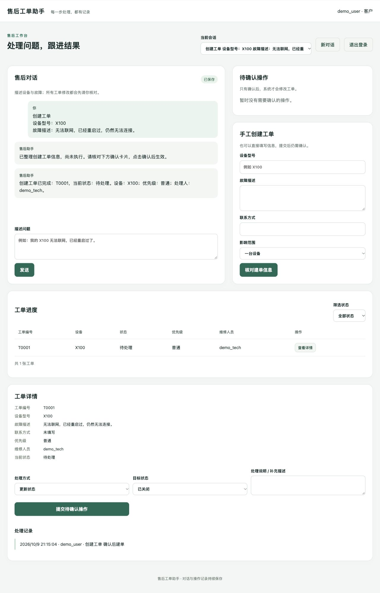

# v3 验收记录：HTTP 工作台与恢复

日期：2026-10-09。环境：本机 macOS / Python 3.12 / 单个 Uvicorn 进程 / SQLite。定位是可部署的单组织试点与实习演示项目；本次没有生产流量、云部署或可用性 SLA 验证。

最终代码与配置的 SHA256、检查结果索引见 [verification-v3-2026-10-09.json](../reports/verification-v3-2026-10-09.json)。本地 `reports/` 默认不纳入 Git，分享时请连同需要的证据一起提供。

## 这次实际增加了什么

| 能力 | 可以演示的行为 | 对应源码 |
|---|---|---|
| HTTP 服务 | 网页通过明确接口提交消息、执行请求、查询工单 | `api.py` |
| 登录与请求保护 | Cookie 不向 JavaScript 暴露令牌；写请求检查来源、CSRF 和数据库角色 | `api.py`、`auth.py` |
| 提交幂等 | 网络重试用相同提交键取回原请求；改正文或会话会冲突 | `sessions.begin_request` |
| 确认写入 | 模型和表单只生成提案，用户确认冻结参数后才能执行 | `actions.py`、HTTP 确认入口 |
| 网页恢复 | 刷新、服务重启后仍能恢复有效登录、对话和确认卡片 | `web/app.js`、SQLite |
| 运维入口 | 健康检查、脱敏请求日志、管理员初始化、备份恢复 | `api.py`、`scripts/db_admin.py` |
| 部署与复现 | 固定依赖、容器配置、CI 配置、独立 HTTP 压测脚本 | 根目录配置、`scripts/load_test.py` |

已有 ReAct、检查点、请求租约、工单状态机和执行预算继续复用。当前执行请求仍等待本轮结果；没有后台任务队列或自动无人值守恢复。

## 自动检查

| 检查 | 实际结果 | 能证明什么 |
|---|---|---|
| `ruff check .` | 通过 | 静态规则检查 |
| `pytest -q` | **82 passed，8.96 秒** | 原业务回归及 HTTP、认证、幂等、恢复边界 |
| 固定场景离线评测 | **50/50** | 脚本模型条件下的业务状态与执行约束 |
| 文档覆盖检查 | **236/236 个具名 Python 函数有讲解索引** | 说明存在，不等同于说明语义完全正确 |

新增回归覆盖：跨用户访问、伪造角色/确认参数、角色变化后重校验、Cookie 刷新/撤销、跨源和缺失 CSRF、持久化登录限流、并发相同提交键、重复确认、检查点中断续跑、快照恢复、旧 URL 令牌拒绝、异常响应与日志不泄露正文。

离线报告：[offline-evaluation-v3-2026-10-09.json](../reports/offline-evaluation-v3-2026-10-09.json)。其中数据库事实一致性为 28/28，合法工具调用为 51/58（含刻意触发的非法调用）；脚本模型 Token 为估算值，不能当作真实模型账单。该报告生成于最后一次 HTTP 异常日志调整之前，Agent 业务层未再变更；HTTP 最终代码另由上述回归测试覆盖。

本轮**没有重新调用付费模型评测**。README 中 2026-10-08 的 v2 DeepSeek 记录保留为历史证据，不能用作 v3 新版真实模型验收。

函数说明覆盖：[annotation-audit-v3-2026-10-09.json](../reports/annotation-audit-v3-2026-10-09.json)。原 169 个函数见 [业务函数讲解](functions.md)，本轮新增/修改 73 个条目见 [HTTP 与运维函数讲解](http-functions.md)，两个文档包含重叠条目。源码使用中文 docstring 或函数前注释，网页具名函数也附有中文说明。

## 真实 HTTP 并发与恢复演练

最终报告：[http-load-v3-final-2026-10-09.json](../reports/http-load-v3-final-2026-10-09.json)。较早的 `http-load-2026-10-09.json` 仅保留为开发过程记录。

- 8 个并发客户端，各执行 10 次，共 **80/80 次完整流程**。
- 每次依次执行：建会话、生成提案、重放提案、确认、重复确认、查详情，共 6 个 HTTP 请求。
- 最终 **80 张工单、80 条创建审计、0 个流程错误**；提案重放和重复确认没有增加工单。
- 平均每流程 **104.30 毫秒**，P95 **261.77 毫秒**，本轮吞吐 **43.39 个流程/秒**。
- 在线备份后恢复到新文件，数量核对通过；恢复库旧登录失效。
- 单独恢复测试还验证了中断的 LangGraph 检查点可以在恢复库继续执行，原库保持不变。

以上是小规模、本机、临时数据库的短时演练，**不含 LLM 推理**。吞吐计时含并发登录，单轮流程耗时不含登录。它不能证明生产容量、持续高负载稳定性或模型服务 SLA。

## 浏览器验收

使用隔离测试账号和临时数据库，实际完成登录、手工提案、刷新恢复确认卡片、服务重启后继续登录、确认建单、查询工单与审计、退出登录。客户页面只显示对应角色与当前状态的处理选项，后端继续独立检查权限。

截图中的 `demo_user`、`demo_tech` 和 T0001 均为隔离验收数据，不是本机运行库中的预设账号或工单。验收服务已关闭。

本机运行库在启动 v3 前已生成 `backups/pre-v3-20261009-212255.sqlite3`，随后迁移到 schema v3。启动时原库没有账号、工单和会话；没有把测试用户复制进去。实际工作台地址为 http://127.0.0.1:8000/，首次管理员应按 [部署指南](deployment.md) 在终端自行设置密码。

## 尚未验证或实现的范围

- 机器没有 Docker；Dockerfile、Compose 和 CI 配置已写好，容器构建、容器启动和远程 CI **未运行**。
- 没有配置真实域名、TLS 代理、统一身份认证或跨租户隔离。
- 备份恢复已演练，但没有定时异机备份、自动切换、RPO/RTO 承诺。
- 没有后台队列、多实例分布式调度或真实模型并发容量测试。

面试中可以介绍 HTTP 分层、可信身份、提交与业务幂等、冻结参数确认、检查点恢复和可复现验收，并说明这些边界。不要将这次演练描述为已有企业线上生产实践。
