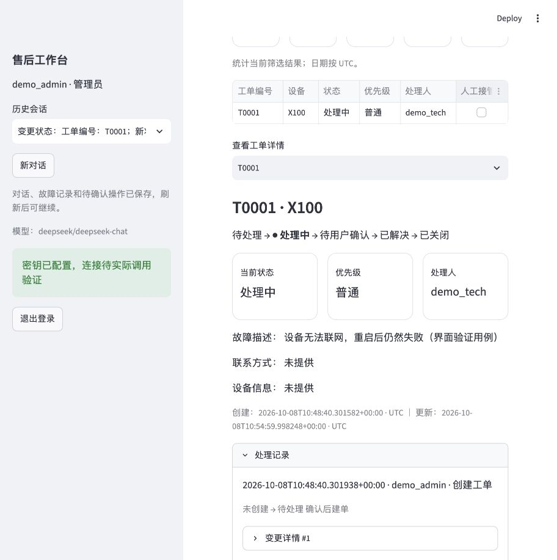

# v2 验收记录

验收日期：2026-10-08。环境：macOS、Python 3.12，模型配置 `deepseek/deepseek-chat`；接口实际返回的 `model_name` 是 `deepseek-flash`。以下为本次固定样本结果。

## 最终结果

| 项目 | 结果 | 证据 |
|---|---|---|
| 本地测试 | 67 passed，6.44 秒 | pytest；事务、权限、并发、页面、检查点、上下文和评测器 |
| 静态检查 | All checks passed | Ruff |
| 离线场景 | 50/50，共 62 轮 | [完整离线报告](../reports/offline-evaluation-v2-final.json) |
| 真实模型场景 | 50/50，共 62 轮 | [完整真实报告](../reports/live-evaluation-v2-final-2026-10-08.json) |
| 真实状态一致性 | 32/32 | 涉及真实工单记录或确认结果的轮次 |
| 真实工具调用合法性 | 62/65，95.38% | 包括有意越权的两次拒绝，以及一次不合法故障类别参数；模型随后纠正 |
| 每轮平均执行耗时 | 1737.57 毫秒 | 请求服务耗时，不含测试账号准备及模拟点击耗时 |
| 真实 Token | 330,059 | 服务端 usage；62 轮均无估算标记 |
| 金额 | 未计算 | 未设置单价，不将未知成本标为 0 |
| 浏览器实际操作 | 通过 | 隔离库内填写、刷新恢复卡片、确认建单、自动分派、跨会话状态更新、详情与记录 |

没有把离线脚本模型的 Token 估算当成真实模型数据。真实模型评测由测试驱动器模拟页面确认按钮；它验证确认入口及前后状态，不表示模型本身有权确认写入。

任务成功率核对预期业务状态、字段、必要工具证据和确认前数据库不变。状态一致性检查明确的状态陈述与创建成功陈述；它不是任意自然语言的完整语义评判。最终可见回复经过可信渲染，原始模型输出也保留在报告中以便对比。`human_review` 保持 `pending`，没有把自动检查当作用户人工签字。

## 本次发现并修复的问题

1. 同步 SQLite 日志阻塞异步检查点写入：异步图节点改用 `asyncio.to_thread` 完成同步数据库操作，避免事件循环互等。
2. 模型只输出“请确认”文字，没有调用状态变更工具：明确工具提案与实际按钮的关系，并补充客户返工、维修完成等合法流转说明。
3. 旧工单故障类别为 other，相似单漏报：以已有故障原文补判类别，并加入回归测试。
4. 长对话排查耗尽后丢失升级售后信息：结构化保存实际剩余步骤和耗尽状态，明确失败反馈后不重复推荐。
5. 模型未验证的最终文本进入下一轮历史：使用相同消息 ID 替换为实际展示的可信回复。
6. 评测把“确认前查询”与“确认后新状态”拼在一起比较：为每条回复保存对应事务时间点的快照；另加测试确保真正的错误状态仍会失败。
7. 刷新后的确认卡片、工作台操作回流与工作人员列表：通过页面测试及实际浏览器操作核验。

保留的中间证据：

- [首次完整真实评测：41/50](../reports/live-evaluation-v2-2026-10-08.json)。
- [修复回归：8/9](../reports/live-v2-regression.json)，仍存在客户返工意图被模型误拒绝，随后修正提示并重新跑完整 50 场景。
- [最终完整真实评测：50/50](../reports/live-evaluation-v2-final-2026-10-08.json)，报告内 SHA256 对应增强版验收时的源码；后续函数讲解仅修改注释，完整 AST（含原有 docstring）与讲解前一致。

最终报告没有覆盖前面的失败报告。FAQ 模拟资料的一条末尾建议是“提交售后”，当前仍作为带来源的诊断步骤展示；它本身不会创建工单，仍需独立提案与页面确认。

## 覆盖的重要边界

- 多个线程同时确认一张卡片，只创建一张工单和一条创建审计。
- 确认参数被修改、过期、跨账号/跨会话、工单版本改变、操作人权限改变时拒绝。
- 客户只能读取自己的工单；员工权限由数据库实际角色决定，模型不能传 operator_id 或 confirmed。
- “不要创建工单”即使被脚本模型忽略，也被执行层拒绝。
- 原请求检查点恢复不会重复执行已经完成的提案；失败重试累计预算不清零。
- 已执行确认再次点击复用原操作，返回当下真实工单状态。
- 型号过滤优先于文本相关性；X100 蓝牙不能引用 X200 的 FAQ。
- 十轮售后对话保留型号、问题、已尝试步骤；裁剪不会拆散工具请求和结果。
- 旧表迁移保留原工单，页面无密钥时仍能执行手工工作台操作。

## 复跑

```bash
.venv/bin/python -m pytest -q
.venv/bin/ruff check .
.venv/bin/python scripts/evaluate.py --mode offline --output reports/offline-new.json
.venv/bin/python scripts/evaluate.py --mode live --concurrency 2 --output reports/live-new.json
```

真实测试会消耗已配置模型用量；测试工单只写隔离临时库。若终端配置的代理不可达，可修复本机代理，或仅对测试命令移除代理环境变量，不修改系统代理设置。

## 历史版本

本轮教学注释覆盖 169 个具名函数，并补充内部调用、链式方法、回调、匿名函数与装饰器说明。[注释一致性核对](../reports/annotation-audit-2026-10-08.json) 保留各文件修改前后指纹及 AST 比较；模型提示词和工具说明未改动，没有为注释改动再次调用付费模型。

[2026-09-28 初版验收](acceptance-v1-20260928.md) 对应仅三个工具的旧实现，不能拿来证明当前增强版功能。旧报告只作项目演进证据。

## 页面运行实图

以下为隔离测试库中的 T0001，已通过页面确认变为处理中；演示数据没有写入默认业务库。


