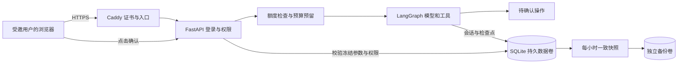

# 受邀演示版部署指南（v4）

本版准备的是**单机、少量受邀用户的演示部署包**。你现在没有服务器和域名，所以暂时无需执行公网部署步骤。本机原有 HTTP 工作台可以继续使用；本次没有申请云资源、发布外网地址或调用付费模型。

## 这次补了什么

| 内容 | 解决的问题 | 主要文件 |
|---|---|---|
| 模型执行门禁 | 先检查并发、频率和日额度，再调用模型；刷新或重启不能清零 | `src/react_agent/quotas.py`、`api.py` |
| HTTPS 入口配置 | 只对外开放 80/443，应用端口留在容器网络 | `compose.demo.yaml`、`deploy/Caddyfile` |
| 每小时自动备份 | 用 SQLite 在线快照 API 备份完整库，成功后更新健康标记 | `scripts/backup_worker.py` |
| 撤销邀请、重置密码 | 停用账号或改密码时，旧登录立即失效 | `scripts/db_admin.py` |
| 恢复与持续检查 | 恢复不覆盖原库，释放旧进程租约；CI 增加容器启动与备份检查 | `tests/test_demo_ops.py`、`.github/workflows/check.yml` |



工单仍需明确确认后才能写入。模型并发席位、业务请求租约、确认幂等、图检查点是不同机制，各自负责预算、安全执行和恢复。

## 模型限额怎么工作

| 配置 | 默认值 | 易懂说明 |
|---|---:|---|
| `DEMO_MODEL_ENABLED` | `true` | 改为 `false` 并重新创建应用容器，暂停新的智能对话；表单仍可用 |
| `DEMO_MAX_CONCURRENT` | 2 | 全站同时最多运行两次 Agent 请求 |
| 每账号同时执行 | 1，固定 | 同一账号开多个会话也不能并行占用多个席位 |
| `DEMO_USER_RUNS_PER_MINUTE` | 6 | 一个账号一分钟最多开始六次执行；重试也计入 |
| `DEMO_USER_DAILY_TOKENS` | 100000 | 一个账号每天最多允许预留的 Token 总额度 |
| `DEMO_DAILY_TOKENS` | 500000 | 全站每天最多允许预留的 Token 总额度 |
| `DEMO_DAILY_COST_LIMIT` | 不启用 | 可选金额门禁，须同时填写输入和输出单价，三项使用同一币种 |

“每天”按 **UTC 00:00** 切换，即北京时间 08:00。每次执行先按现有 `Context.max_tokens=16000` 预留，因此剩余额度低于 16000 时也会拒绝新执行。一次 Agent 请求可能内部调用模型多次；次数和总执行时间仍受 `Context` 控制。

执行成功且拿到准确 usage 时，只扣本次增量，退回多余预留。重试复用原请求，但不会把前一次已经计算的准确用量重复相加。如果有估算、超时或未知结果，则保留本次预留值，必要时按更大的已知用量计算。程序崩溃后，席位约 160 秒到期释放；未知用量仍占当天预算。已完成请求直接返回保存的结果，不再占用席位或计次。

拒绝时返回 HTTP 429、明确错误码和 `Retry-After`，消息已经保存，页面可以继续原请求或结束它再使用表单。`GET /api/admin/metrics` 的 `model_budget` 仅向管理员返回当天预留及结算总量，不泄露聊天正文。

金额由配置单价估算，不是供应商账单硬上限：输入 Token 预检有误差，超时请求可能已经被供应商处理，实际价格也可能不同。建议同时在模型供应商后台设置可用的消费额度。恢复到较早快照也会回退快照之后的本地计数，恢复当天应先暂停模型并核对供应商用量，再设置剩余额度。

这些限制位于 HTTP 执行入口。公网只部署本指南的 HTTP 应用；本机 Streamlit 和直接运行评测脚本不会经过这个门禁，不能同时把它们暴露给外部用户。

## 有服务器以后再操作

准备一台装好 Docker Engine 和 Compose v2 的 Linux 服务器、一个专用域名。先将域名 DNS 指向服务器，只开放所需管理端口及 TCP 80/443，不开放 8000。模板面向 Caddy 直接接收公网连接；如果外面还有 CDN 或负载均衡，需要另行调整代理信任链。

本机目前没有 Docker，所以以下容器命令已准备，**尚未在本机执行容器构建和启动，也未验证真实证书签发**。固定业务依赖在 `requirements.lock.txt`；`python:3.12-slim` 和 `caddy:2` 是可更新的镜像标签，正式发布时应记录并固定验收通过的镜像 digest。

1. 把项目代码复制到服务器，包含隐藏的配置模板、`deploy` 和 `scripts`。不要上传本机 `.env`、实际数据库、虚拟环境或测试报告。
2. 在服务器项目目录准备配置：

```bash
cp -n .env.demo.example .env.demo
chmod 600 .env.demo
```

填写 `.env.demo` 中的 `DEMO_DOMAIN`（例如你实际持有的专用域名，不含协议/路径）、模型密钥和限额。密钥为空时应用仍能启动，智能对话提示未配置。`APP_ORIGIN` 由 Compose 生成，不用手工再填。

3. 校验、构建和初始化首个管理员：

```bash
docker compose --env-file .env.demo -f compose.demo.yaml config --quiet
docker compose --env-file .env.demo -f compose.demo.yaml build
docker compose --env-file .env.demo -f compose.demo.yaml run --rm --no-deps ticket python -m scripts.db_admin bootstrap --db /data/tickets.sqlite3 --user admin
docker compose --env-file .env.demo -f compose.demo.yaml up -d --wait --wait-timeout 180
```

初始化命令提示输入密码，不在命令行放密码。仅首次空库执行初始化；已有管理员时跳过。随后打开实际 HTTPS 域名，管理员登录并添加受邀客户/工作人员。使用模拟设备与故障数据演示，不填写真实个人资料。

`ticket-data` 保存业务、会话、检查点和限额；`ticket-backups` 保存快照；Caddy 的两个卷保存证书和配置。常规停止使用 `down`，**不要加 `-v`**，否则会删除数据卷。不要随意改变项目目录名或 Compose 项目名，它会改变默认卷名称。

Caddy 的固定内部地址为 `172.30.60.2`，Uvicorn 只信任这个地址发来的转发头。若服务器已有冲突网段，需要同步修改网络配置、Caddy 内部地址和应用的 `--forwarded-allow-ips`。应用没有宿主机端口映射，仍可访问外部模型服务。仅启动一个应用实例、一个 worker，SQLite 放本机持久磁盘。

## 上线前怎样验收

| 操作 | 应看到的结果 |
|---|---|
| 打开实际域名；访问 HTTP 地址 | HTTPS 证书有效，HTTP 跳转 HTTPS |
| 检查 `/health/ready` | 返回 ready；这只表示数据库可读，不保证模型可用 |
| 管理员创建测试客户，客户登录 | 登录后能刷新恢复；没有公开注册入口 |
| 客户通过表单提出建单 | 出现确认卡片，确认前工单列表不新增 |
| 确认后刷新、重复点击确认 | 只有一张工单，详情状态与处理记录一致 |
| 用另一客户查看该会话或工单 | 被拒绝或不可见 |
| 设置很低的测试日额度，例如 1000，重新创建应用，再发智能对话 | 返回额度不足且无模型调用；表单仍可操作；验收后恢复计划限额 |
| 填好模型密钥并主动进行一次实际对话 | FAQ 引用型号正确；建单先出卡片，确认后编号可查询；这一步会产生模型费用 |
| 重启 ticket 后重新打开页面 | 账号、聊天、工单保留，未完成请求可继续原编号 |
| 查看 backup 健康状态并执行下述恢复演练 | 最近成功快照存在，新库中记录可读，旧登录被撤销 |

配置改变后使用 `up -d --force-recreate ticket`，单纯 `restart` 不会重新加载 Compose 环境文件。模型关闭只影响新开始的执行，不会自动中断已经发给供应商的调用。

```bash
docker compose --env-file .env.demo -f compose.demo.yaml ps
docker compose --env-file .env.demo -f compose.demo.yaml logs --tail=100 ticket backup edge
docker compose --env-file .env.demo -f compose.demo.yaml restart ticket
docker compose --env-file .env.demo -f compose.demo.yaml exec backup python -m scripts.backup_worker --directory /backups --check-health
```

日志只记录受控 HTTP 信息与备份状态，配置文件和密钥不要粘贴到公开报告。记录验收日期、源码版本、镜像 digest、模型版本、测试结果和实际用量。当前本地证据见 [v4 验收记录](acceptance-v4.md)，不能把它当成服务器的验收结果。

## 备份、恢复与回滚

备份容器没有外网和模型密钥，每小时尝试一次备份。通过 SQLite 在线 backup API 生成一致快照，再校验并更新成功标记；超过 7500 秒没有成功快照就不健康。Docker 不会仅因 unhealthy 自动重启容器，也没有外部报警，需要运营者检查或接入监控。

独立备份卷仍在同一台服务器上，不能防整机磁盘丢失。需要定期把已校验的快照导出到受控的异机位置；本版没有配置云存储或自动删除旧快照，需监测空间并按保留策略归档。每小时快照只是执行计划，不是数据恢复时限承诺。

恢复命令始终写入**不存在的新文件**，不会覆盖旧库。先查看实际备份文件名：

```bash
docker compose --env-file .env.demo -f compose.demo.yaml exec backup ls -l /backups
docker compose --env-file .env.demo -f compose.demo.yaml stop ticket backup
# 将下面的实际快照文件名换成上一步看到并选定的文件。
docker compose --env-file .env.demo -f compose.demo.yaml run --rm --no-deps backup python -m scripts.db_admin restore --source /backups/实际快照文件名.sqlite3 --destination /data/restored.sqlite3
```

检查恢复命令输出的工单数、请求数、版本和 SHA256。先在 `.env.demo` 设置 `DEMO_MODEL_ENABLED=false`、`DEMO_DB_FILE=restored.sqlite3`，再执行 `up -d --force-recreate ticket backup`。应用和备份进程会一起改用新文件；核对聊天、工单和预算后再开启模型。旧库保留在原文件，不同时启动两套业务实例写入新旧库。

恢复会撤销所有旧登录，并释放请求租约与模型执行席位；不会删除预算预留，也不会重新授权已过期的确认卡片。若回滚应用版本，应使用对应版本的镜像及已验证匹配的快照，不能只把旧代码直接指向未知的新表结构。

## 撤销邀请和重置密码

以下操作由能访问服务器的管理员执行；这里示例使用初始数据库文件名，恢复切换后要改为当前 `DEMO_DB_FILE` 对应文件：

```bash
docker compose --env-file .env.demo -f compose.demo.yaml exec ticket python -m scripts.db_admin disable-user --db /data/tickets.sqlite3 --user demo_customer
docker compose --env-file .env.demo -f compose.demo.yaml exec ticket python -m scripts.db_admin reset-password --db /data/tickets.sqlite3 --user admin
```

两种操作都会撤销该账号全部旧登录。停用不会删除工单、聊天或审计；不能停用最后一个有效管理员。重置密码不会把已停用账号重新启用。

## 学习这次改动

按 `api.run → quotas.acquire → service.run_request → quotas.settle` 阅读，理解“预留、执行、结算”。再看 `backup_worker.backup_once → db_admin.copy_database`，对比备份、恢复、检查点和幂等的职责。新增函数都有中文功能与调用说明，完整索引见 [HTTP 与运维函数讲解](http-functions.md)。

入口配置参考官方 [Caddy 反向代理说明](https://caddyserver.com/docs/caddyfile/directives/reverse_proxy)、[请求体大小限制](https://caddyserver.com/docs/caddyfile/directives/request_body) 和 [自动 HTTPS 说明](https://caddyserver.com/docs/automatic-https)。本模板设置请求体上限 64KB、上游响应头等待 120 秒；实际证书和代理链需要在目标服务器验收。
