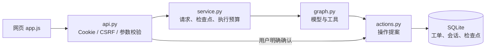

# HTTP 服务、部署与恢复（v4）

这是面向单组织、小团队试点的可部署版本。网页通过 HTTP 接口访问已有业务层，模型工具仍只能提出操作，确认入口继续使用权限检查、冻结参数、事务与幂等。

本文介绍本机入口与接口基础；真实域名部署请读 [受邀演示版指南](demo-deployment.md)，其中包含 v4 的模型配额、HTTPS 模板、定时备份、账号撤销和上线验收步骤。

## 先启动本机版本

在项目目录执行（需要 Python 3.12）：

```bash
python3.12 -m venv .venv
.venv/bin/python -m pip install -c requirements.lock.txt -e '.[dev]'
cp -n .env.example .env
# 首次使用且数据库没有账号时执行；已有管理员不要重复初始化。
.venv/bin/python -m scripts.db_admin bootstrap --db data/tickets.sqlite3 --user admin
# 按提示输入密码，密码不会放进命令历史。
.venv/bin/python -m uvicorn react_agent.api:create_app --factory --host 127.0.0.1 --port 8000 --no-access-log
```

打开 http://127.0.0.1:8000/。管理员登录后在页面添加客户或工作人员。已有 v2/v3 账号继续有效，数据库自动升级为 schema v4，保留原业务记录；旧地址中的会话令牌不再被网页接受。切换版本前先备份，迁移已在隔离测试库验证。

配置 `APP_ORIGIN=http://127.0.0.1:8000`，访问地址的协议、主机、端口要与配置一致。模型配置仍由 `.env` 提供；没有模型密钥时手工建单、确认和状态处理仍可用。不要把 `.env` 放进版本库或镜像。

Streamlit `app.py` 保留为本机调试入口。其登录令牌只存在服务端 `session_state` 中，重新打开页面可能需要重新登录；业务记录仍保存在数据库。需要刷新后保持登录时使用新的 HTTP 网页，Cookie 默认有效 12 小时。

## 请求从哪里经过



API 与静态网页同源，无需 CORS 放行。HTTP 处理与业务处理仍是一个进程；新增接口没有引入后台任务队列。`run` 请求等待本轮处理完成，遇到失败或服务重启后由用户重新触发原请求。模型调用和总执行时间继续采用原服务层预算。

## 登录和请求保护

- 登录通过 JSON POST 提交；首次管理员只允许在本机管理命令初始化，HTTP 没有 bootstrap 或公开注册入口。
- 会话采用 HttpOnly、SameSite=Lax、Host-only Cookie。HTTPS 站点自动设置 Secure；非本机的明文站点配置会被拒绝。
- `GET /api/session` 返回当前用户和 CSRF 证明，不返回会话令牌。所有修改接口都检查精确匹配的 `Origin`；已登录修改还要求 `X-CSRF-Token`。
- 角色每次从数据库读取；用户不能通过正文传 `user_id`、`role`、`confirmed` 等字段越权。
- 同账号每分钟最多 10 次登录尝试；同来源每分钟最多 30 次。计数持久化到 SQLite，重启不清零。它是基础限流，不是完整的网络攻击防护。
- API 校验错误不回显密码等输入；HTTP 日志只记路由模板、响应状态、耗时和随机跟踪编号，省略正文、Cookie、查询串。
- 工单正文和对话仍含客户资料。部署者需管理数据库/备份访问、保留期限、日志收集以及发给模型的业务数据范围。

## 常用接口

| 方法与路径 | 用途 | 额外要求 |
|---|---|---|
| `POST /api/login` | 登录并设置 Cookie | 同源、JSON 账号密码 |
| `GET /api/session` | 刷新恢复登录和 CSRF 证明 | Cookie |
| `POST /api/logout` | 撤销登录 | Cookie、Origin、CSRF |
| `GET /api/threads` | 本人会话列表 | Cookie |
| `POST /api/threads` | 新建会话 | 写操作验证 |
| `GET /api/threads/{id}` | 聊天记录、记忆、未完成请求、确认卡片 | 本人会话 |
| `POST /api/threads/{id}/requests` | 保存一条消息，返回请求编号 | 写操作验证、`Idempotency-Key` |
| `POST /api/requests/{id}/run` | 执行或续跑同一个请求 | 本人请求、写操作验证 |
| `GET /api/requests/{id}` | 查询请求结果 | 本人请求 |
| `POST /api/requests/{id}/abandon` | 结束未完成请求 | 活动租约结束后才允许 |
| `POST /api/threads/{id}/proposals` | 表单提出业务操作 | 白名单字段、写操作验证、幂等键 |
| `POST /api/operations/{id}/confirm` | 确认/取消冻结操作 | 所属会话、写操作验证；不接受替换操作参数 |
| `GET /api/tickets` | 筛选可见工单 | `thread_id`，可选状态/型号/编号 |
| `GET /api/tickets/{id}` | 详情与处理历史 | 所属权限、`thread_id` |
| `GET/POST /api/admin/users` | 列举/添加用户 | 管理员，POST 还需写操作验证 |
| `GET /api/admin/metrics` | 工单数量、请求状态、当天模型预留及结算计数 | 管理员 |
| `GET /health/live`、`GET /health/ready` | 进程/数据库探活 | 不检验模型质量或远程模型可用性 |

OpenAPI 在 `/openapi.json`，接口说明在 `/docs`。浏览器自带页面负责携带 CSRF 证明；独立客户端需要先登录、保存 Cookie，再将返回的证明放在请求头。Swagger 的请求也必须显式配置必要请求头，不能绕过安全校验。

`Idempotency-Key` 是客户端对“一次提交”生成的随机编号，格式为 8–128 位字母数字、下划线或连字符。同一用户、同一键、同一会话和正文返回原 `request_id`；改变正文或会话会冲突。新业务提交必须换新键。网页只在 `sessionStorage` 留下提交键和正文指纹，网络错误时复用，不保存密码或会话令牌。

## 容器部署配置

```bash
docker compose build
docker compose run --rm ticket python -m scripts.db_admin bootstrap --db /data/tickets.sqlite3 --user admin
docker compose up -d
```

镜像使用非 root 用户；业务数据放独立 volume；配置文件、实际数据库和报告不进入镜像。默认只发布到本机 `127.0.0.1:8000`。固定依赖从 `requirements.lock.txt` 读取。项目以 editable 方式安装到 `/app`，使现有资料路径解析与本机一致。

本次机器没有 Docker，容器配置与 CI 已提供，**尚未在本机实际构建/运行容器**。原生 Uvicorn 的 HTTP、浏览器流程、并发和恢复已经实测；不能把这些记录描述为容器验收结果。

如以后放到真实域名：使用 v4 的 `compose.demo.yaml`，由 Caddy 处理证书，配置中只信任固定代理地址；实际 HTTPS 和客户端 IP 链仍需在服务器验收。当前没有创建云资源，也没有统一身份认证或多租户隔离。

`.github/workflows/check.yml` 会在推送/PR 时安装固定依赖、运行检查和离线测试、构建镜像、校验 Caddy 配置并启动应用/备份容器做健康检查。本地文件已准备，尚未推送或执行远程 CI。

## 备份和恢复演练

备份使用 SQLite 的在线 backup API，包含同库中的业务记录与 LangGraph 检查点，避免直接复制正在写入的数据库文件。输出文件权限为 `0600`；快照含私人业务信息，应放在受控位置，异机保存时另行配置加密和访问权限。

```bash
.venv/bin/python -m scripts.db_admin backup --source data/tickets.sqlite3 --destination backups/tickets-20261009.sqlite3
.venv/bin/python -m scripts.db_admin restore --source backups/tickets-20261009.sqlite3 --destination data/restored-20261009.sqlite3
```

目标必须是**不存在的新文件**，命令不会覆盖运行库。恢复过程校验数据库、保留业务和检查点、撤销全部旧登录令牌，并释放中断请求租约与模型席位；保留已预留的日预算。需要重新登录；待确认操作仍遵循原有效期，过期操作不能恢复为授权。

真正切换前，应停止原服务的写入，核验恢复内容，再修改 `TICKET_DB_PATH` 指向恢复库并启动。不要让两个正在接收业务的实例分别写入新旧数据库。这里没有自动切换、定时异机备份或灾备 SLA。

## 可复现的 HTTP 压测

```bash
.venv/bin/python -m scripts.load_test --clients 8 --iterations 10 --output reports/http-load-new.json
```

脚本自行创建临时数据库和账号，启动独立本机端口，结束后关闭服务并清理测试库。每位客户端顺序执行“新会话 → 提案 → 重放提案 → 确认 → 重复确认 → 查询详情”，共 6 次 HTTP 请求。最后核对工单和审计数量，并执行一次真实备份恢复。

报告统计的是完整业务流程的延迟与吞吐，**不包含 LLM 推理**；吞吐计时含并发登录，单轮延迟不含登录。不能把这个结果当成模型并发容量或线上 SLA。扩大到真实业务时，需另外测模型限流、长对话、数据库增长和外部依赖故障。

## 学习顺序

先读 `api.py` 的 `submit_message → run → confirm`，再回到 `sessions.begin_request` 对比客户端提交键和服务端请求编号；随后阅读 `db_admin.copy_database` 和恢复测试，理解为什么恢复库要撤销登录、释放旧租约，却不能重新授权过期操作。新增函数的作用与主要调用均写在函数 docstring 中，网页函数在 `app.js` 内有对应注释。
