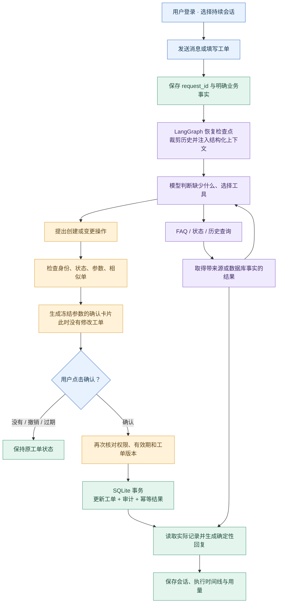
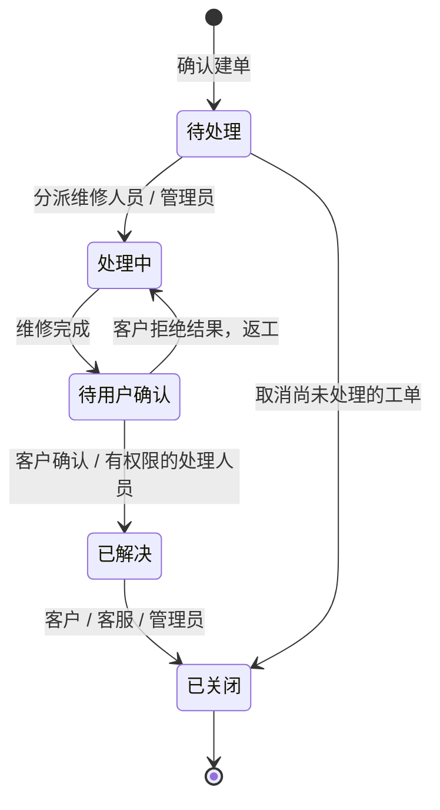

# v2 工作流程

先看两条主线：聊天负责理解和提出操作，页面确认负责真正写入。

## 工单生命周期与权限

每次变更都必须经过确认卡片。普通客户不能把“待处理”直接改成“处理中”或“已解决”。关闭后不可补充或继续流转，需要重新建单。

## 一个具体例子

“我的 X100 无法联网” → 按 X100 和 network 过滤资料 → 返回 FAQ-001 的一个未尝试步骤 → 用户反馈后记录该步骤 → 继续排查或建议售后。

“帮我建单” → 冻结型号和故障 → 检查相似未关闭工单 → 展示确认卡片 → 用户点击 → 校验参数摘要与账号 → 事务提交 → 返回真正的 T 编号。

模型即使自行填写 `confirmed=true`、伪造成功文字或尝试调用确认函数，也无法通过这条写入边界。最终业务回复不直接使用这些文字。
